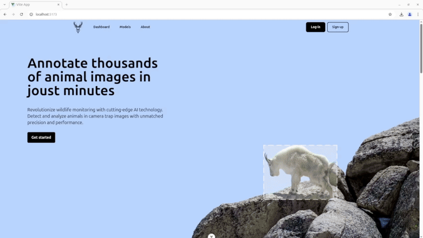
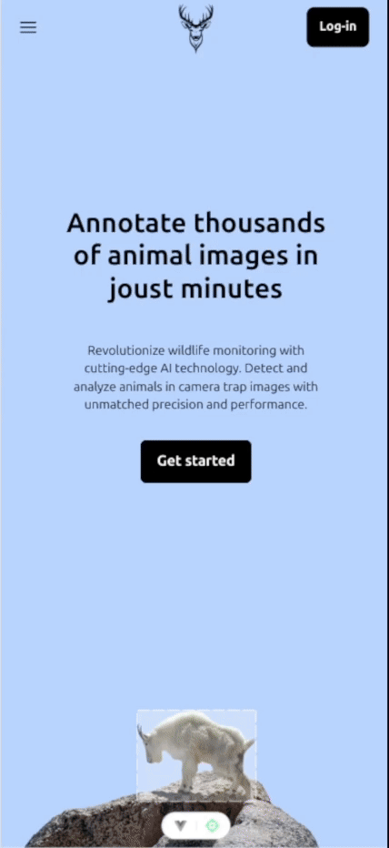

<!-- omit in toc -->

# Wildlife recognition dashboard

<p align="center">
  
  
  
  
  
  
</p>

Extension of my master's thesis, which enables easy use of models trained during my research. It uses Vue.js on the frontend and Python on the backend. If you are interested in my master's thesis check out the repository below:

- [WS-DETR model](https://github.com/matej2000/rtdetr_pytorch_wsdetr)

<!-- omit in toc -->

### Table of Contents

- [Wildlife recognition dashboard](#wildlife-recognition-dashboard)
  - [Table of Contents](#table-of-contents)
  - [Website recordings](#website-recordings)
  - [Website screenshots](#website-screenshots)
    - [Desktop view](#desktop-view)
    - [Mobile view](#mobile-view)
  - [Project Setup](#project-setup)
    - [Build and run for Development](#build-and-run-for-development)
    - [Build for production](#build-for-production)
    - [Stop application](#stop-application)

## Website recordings

**Desktop view:**

<!--  -->

<!-- <video controls width="960" height="540">
  <source src="assets/2025-03-06 22-44-23.mp4" type="video/mp4">
</video> -->


**Mobile view:**

<!-- <video controls width="375">
  <source src="assets/mobile_view.gif" type="video/mp4">
</video> -->



<!--  -->

## Website screenshots

### Desktop view

**Home section:**


<!--  -->

**Dashboard:**


<!--  -->

### Mobile view

**Home section:**


<!-- .png) -->

**Dashboard:**


<!-- .png) -->

## Project Setup

```sh
git clone https://github.com/matej2000/wildlife_recognition_vue.git
cd wildlife_recognition_vue
```

### Build and run for Development

```sh
docker compose --build -f compose.dev.yaml up
```

### Build for production

```sh
docker compose up --build
```

### Stop application

```sh
docker compose down
```
