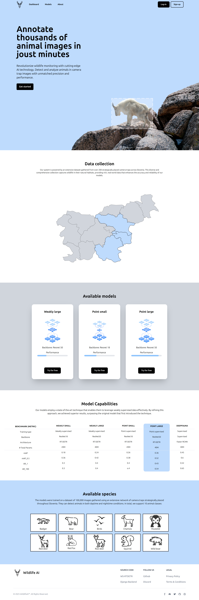
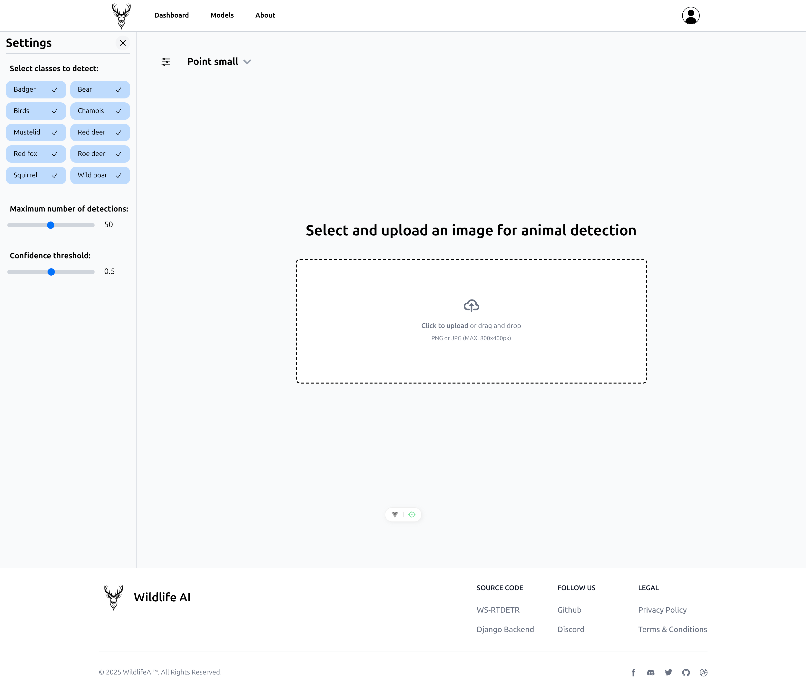

<!-- omit in toc -->
# wildlife_recognition_vue

Extension of my master's thesis, which enables easy use of models trained during my research. This repository contains the frontend made with Vue.js and tailwind css. Which enables a responsive design and fast loading times. The rest of the project is available here:
- [Backend](https://github.com/matej2000/wildlife_recognition_django)
- [WS-DETR model](https://github.com/matej2000/rtdetr_pytorch_wsdetr)

<!-- omit in toc -->
### Table of Contents

- [Website recordings](#website-recordings)
- [Website screenshots](#website-screenshots)
  - [Desktop view](#desktop-view)
  - [Mobile view](#mobile-view)
- [Recommended IDE Setup](#recommended-ide-setup)
- [Customize configuration](#customize-configuration)
- [Project Setup](#project-setup)
  - [Compile and Hot-Reload for Development](#compile-and-hot-reload-for-development)
  - [Compile and Minify for Production](#compile-and-minify-for-production)

## Website recordings

**Desktop view:**

<video controls width="960" height="540">
  <source src="assets/2025-03-06 22-44-23.mp4" type="video/mp4">
</video>

**Mobile view:**

<video controls width="375">
  <source src="assets/mobile_view.mp4" type="video/mp4">
</video>

## Website screenshots

### Desktop view

**Home section:**


<!--  -->

**Dashboard:**


<!--  -->


### Mobile view

**Home section:**


<!-- .png) -->

**Dashboard:**


<!-- .png) -->


## Recommended IDE Setup

[VSCode](https://code.visualstudio.com/) + [Volar](https://marketplace.visualstudio.com/items?itemName=Vue.volar) (and disable Vetur).

## Customize configuration

See [Vite Configuration Reference](https://vite.dev/config/).

## Project Setup

```sh
npm install
```

### Compile and Hot-Reload for Development

```sh
npm run dev
```

### Compile and Minify for Production

```sh
npm run build
```
